# MccInfo

Client-side Qol mod for [MCC Island](https://mccisland.net), Minecraft 26.2 and 26.3.

## Requirements

Each Minecraft version has its own MccInfo jar, made for its own versions of Fabric and Noxesium:

| Minecraft | Branch | [Fabric Loader](https://fabricmc.net/use/) | [Fabric API](https://modrinth.com/mod/fabric-api) | [Noxesium](https://modrinth.com/mod/noxesium) |
|---|---|---|---|---|
| 26.3 | `mc/26.3` | 0.20.1 or newer | 0.166.2+26.3 or newer | 3.3.0 or newer |
| 26.2 | `mc/26.2` | 0.19.3 or newer | 0.157.0+26.2 or newer | 3.2.3 or newer |

Use the jar that matches your Minecraft version (its name starts with `mccinfo-26.2+` or `mccinfo-26.3+`).

[Simple Voice Chat](https://modrinth.com/plugin/simple-voice-chat) is optional.

## Features

Open the MccInfo menu to turn each feature on or off.
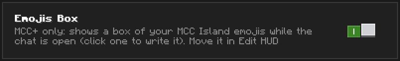

### Fishing
- **Fishing Messages**: moves fishing messages out of the chat into their own movable box, optionally only in fishing instances
- **Compact Fishing Messages**: merges each catch into one line with the item icon, triggered perks and earned XP
- **Fish Collection**: every fish you caught, your equipment and your perks
- **Best Island**: marks the island with the best chance of a new fish
- **Perk Levels**: the level of each perk on its item in the Fishing Perks and Fishing Supplies menus, alone or as a small level/max

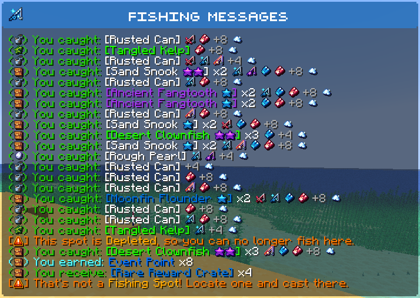
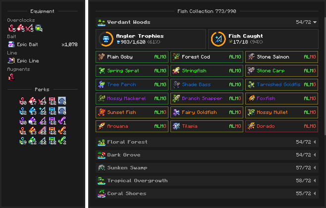

### Events
Each MCC Island event gets its own page of settings and features in the MccInfo menu.

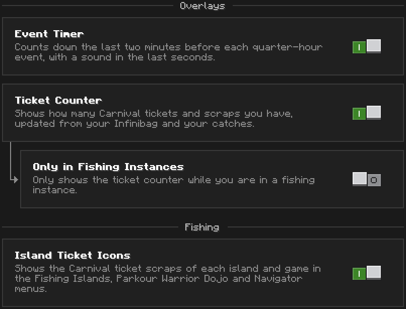

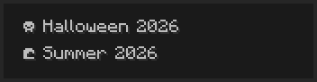

### Items
- **Item list**: searchable list of MCC Island items next to your inventory, with a calculator in the search bar
- **Recipes**: click an item to see its recipes and where it is used, from the list or any inventory (Hold Recipe Mode)
- **NPC path**: shows the way to the vendor of an item
- **Inventory Buttons**: command buttons next to your inventory
- **Cosmetic Preview**: see your player wearing the cosmetic you hover, Middle Click to lock several and try a full outfit, with tints and Chroma Sets
- **Tax Calculator**: when you list an item in the Island Exchange, see the coins you really receive after the 3% tax, or type the amount you want and the price is filled in
- **Better Item Amounts**: in MCC Island menus (Infinivault, Island Exchange, Fishing Supplies...), items show how many you really have instead of the vanilla stack count, shortened to 3 characters (1.5k, 12k, 0.1M...), with the bait you have left

<table>
  <tr>
    <td align="center">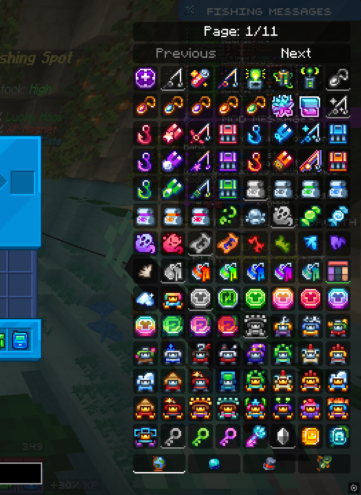 Item list</td>
    <td align="center"> Recipe preview</td>
  </tr>
  <tr>
    <td align="center">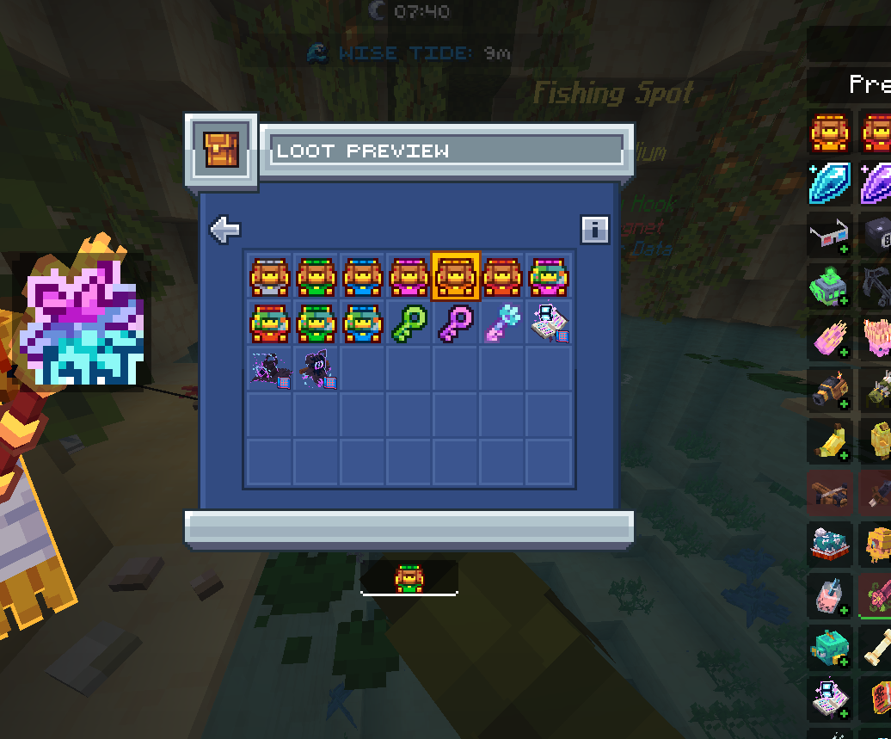 Loot preview</td>
    <td align="center">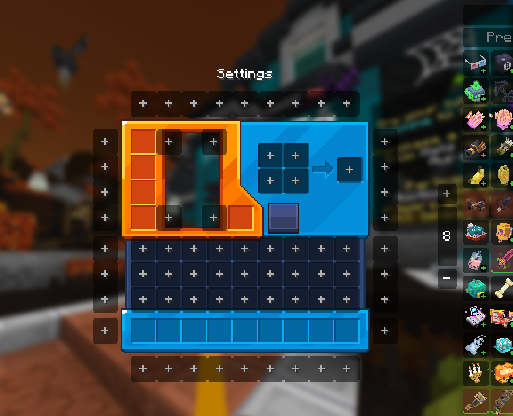 Inventory Buttons</td>
  </tr>
</table>

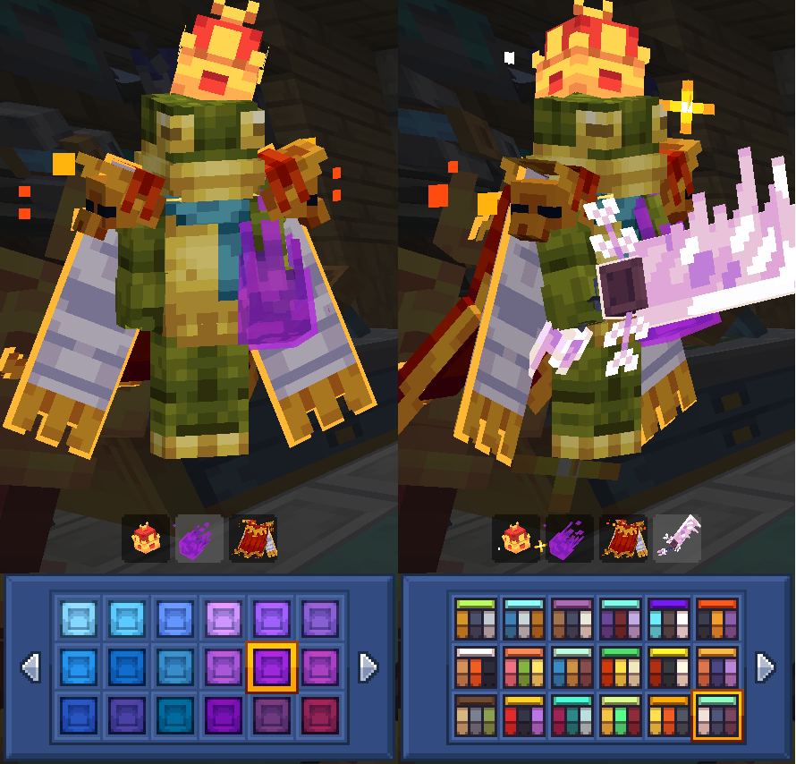

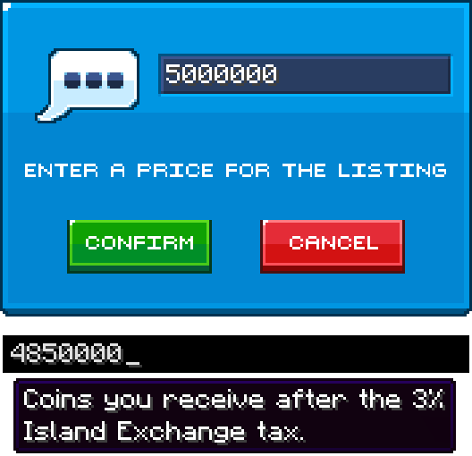

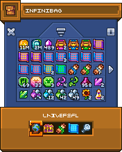

### Badges (with your MCC Island Api Key)
- **Badge Tracker**: every badge in one menu, with your progress on each tier and the estimated games left
- **Suggested Badges**: the badges you are closest to finishing
- **Badge Notifications**: a notification when a game you need for your badges gets busy

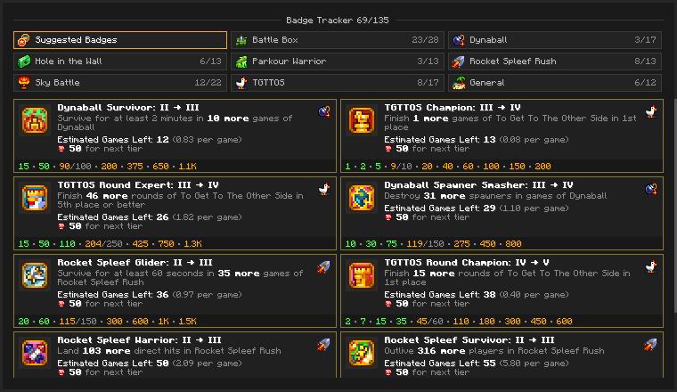

### Chat
- **MccInfo Chat**: talk with every MccInfo player, in the chat or in its own movable box, with an optional message sound
- **Chat Ping**: your name becomes @YourName and the message is highlighted, with an optional sound and taskbar flash
- **Copy Chat Messages**: Ctrl + Right Click a message to copy it
- **Emojis Box** and **Auto Emojis** (MCC+): pick your MCC Island emojis in a box, or type their names like `:smile:`
- **Share items**: press Copy Item on an item, then write `<item>` in the MccInfo Chat to share it with its full tooltip

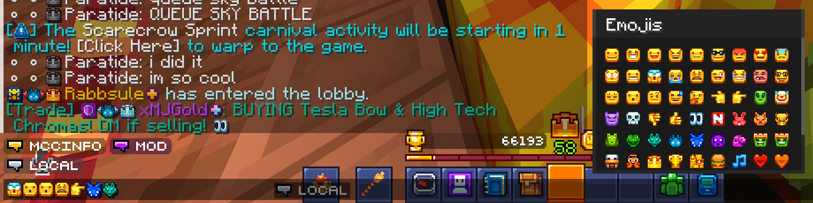

### Voice Chat (with Simple Voice Chat, and only on MccIsland)

> [!WARNING]
> The voice chat is not endorsed, managed or moderated by The Noxcrew, and The Noxcrew is not responsible for anything said or done in it.

- Talk with nearby MccInfo players in the same instance
- Voice controls, volumes per player, groups you can join from any MCC Island server
- Microphone settings: gain, auto gain, noise suppression, push to talk or voice activation, microphone test
- Voice icons next to the names of MccInfo players

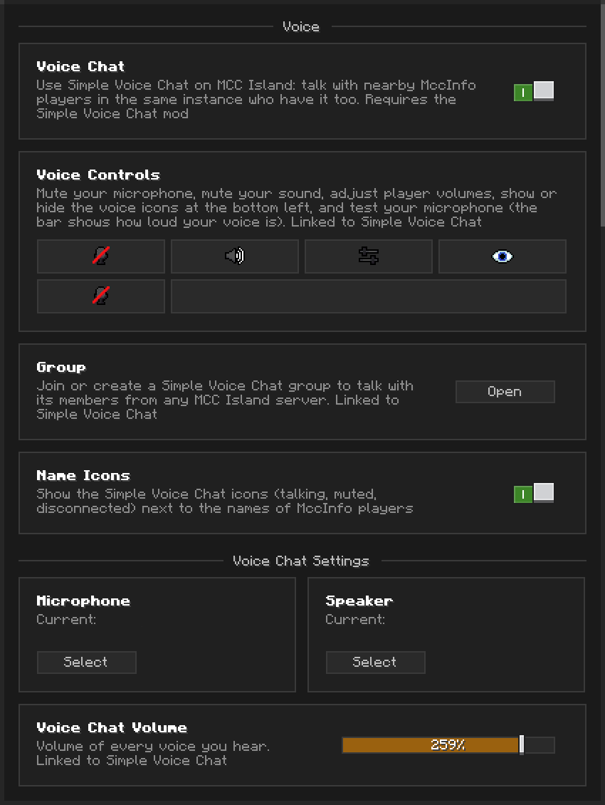

### Parkour
- **Parkour Splits**: in the Parkour Warrior Dojo, times each module of your run and saves your times for each course
- **Timer**: the module you are in and your time in it, at the top of the screen
- **Improvements**: how much faster or slower you are than your best or average time, in the chat, the medal title or the Fishing Messages box

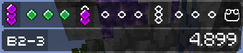

### Utils
- **Wipe to Black**: replaces the server's fade transition with a wipe
- **Keybinds Layout**: see your keybinds on a keyboard and assign them more easily
- Patch notes shown in game after each update

## Updates

When the MccInfo relay asks for a newer version, a toast tells you which version you need and opens the download link (https only, after a confirmation). You replace the jar in your mods folder yourself. You can open the toast again with `/mccupdate`.

The mod in this repository has **no automatic update**: it never downloads, replaces or deletes anything on its own.

Automatic updates are a separate private part, only given to my closed beta testers. It is not in this repository, and I do not suggest building a version with it inside. Even a beta tester only gets updates from the relay if they have the `autoupdate` permission: the mod without the private part never installs anything, with or without the permission.

For beta testers, every automatic update goes through these checks before it replaces the mod:

- **Pinned connection**: the jar is downloaded only from the MccInfo relay, over TLS pinned to the relay's public key, with no redirects.
- **Size**: the file must have exactly the size announced by the relay (64 MB at most).
- **SHA-256**: the hash of the downloaded file must match the one announced by the relay.
- **Ed25519 signature**: the version and the hash must be signed by the MccInfo update key. The private key never leaves the developer's computer and is not in this repository. A jar that fails any check is deleted.
- **No downgrade**: an older version is never installed.
- **Only its own jar**: the update replaces the running MccInfo jar and nothing else in your mods folder.

## Credits

- [Essential](https://github.com/SparkUniverse/Essential-Mod) and [Island Utils](https://github.com/AsoDesu/IslandUtils), whose menu and interface style MccInfo follows to keep a consistent UI with the mods players already use.
- [Island Utils](https://github.com/AsoDesu/IslandUtils) (MIT License): the Parkour Warrior Dojo splits (module timer, best and average times) are adapted from its splits module, and the Cosmetic Preview is based on its idea.

> [!NOTE]
> MccInfo is not affiliated with, endorsed by or associated with The Noxcrew or Mojang.

## License

Copyright (c) 2026 Leroidesafk. All Rights Reserved. See [LICENSE](LICENSE).
