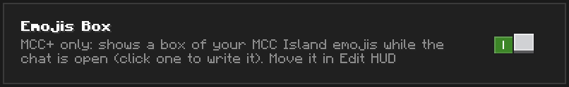
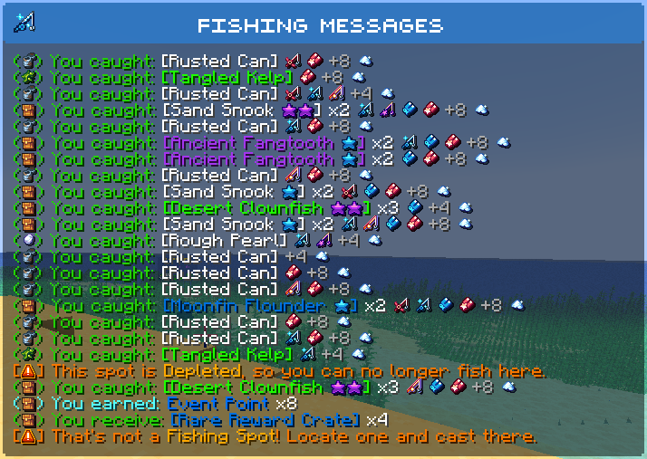
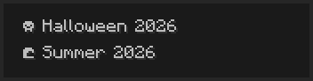
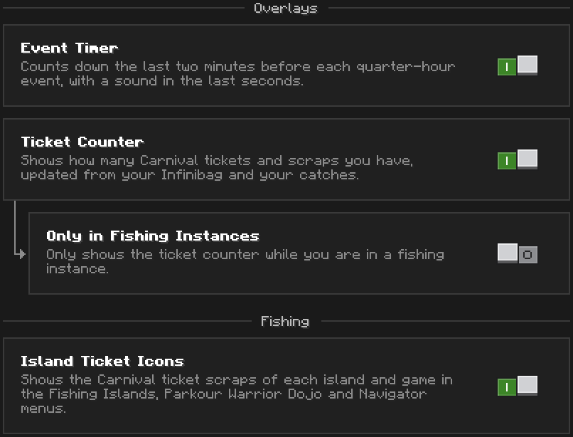
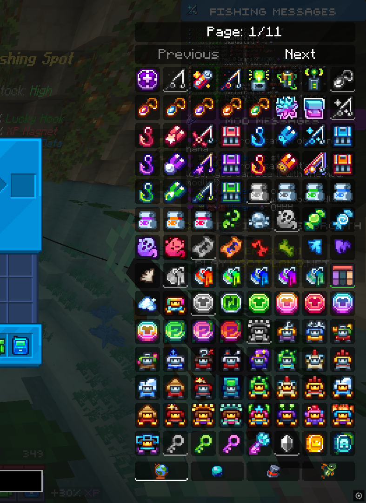
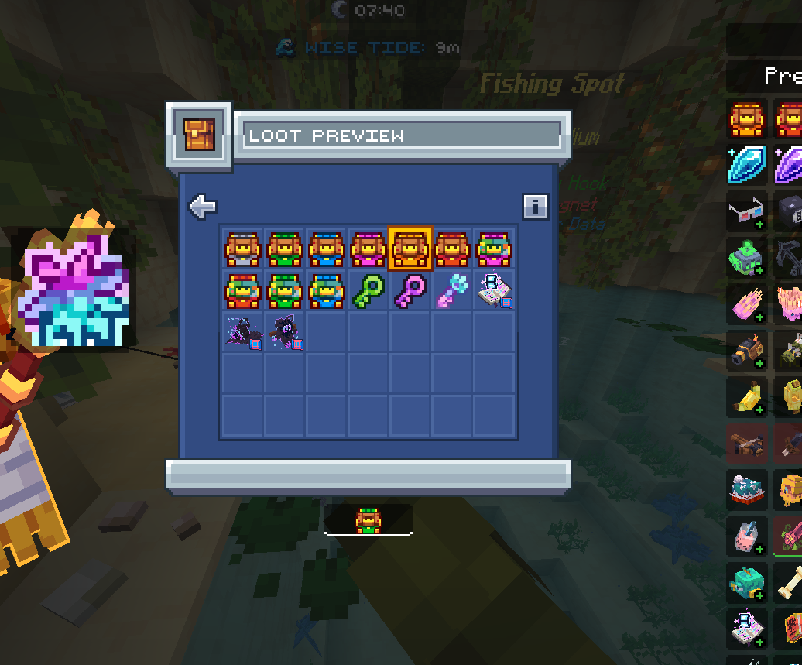
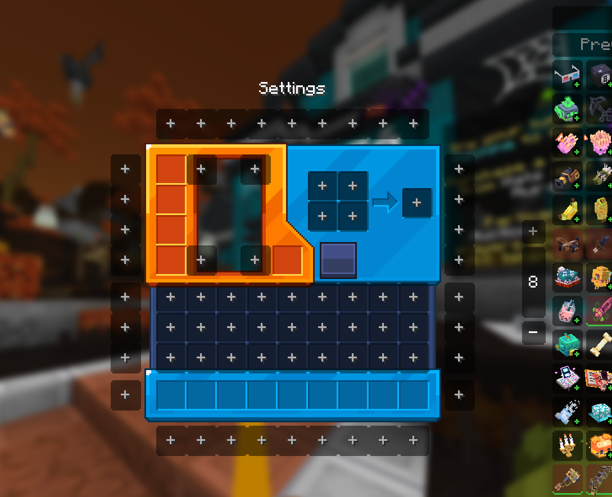
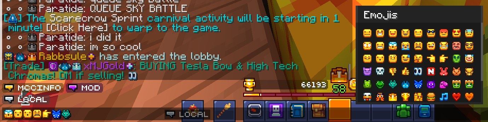
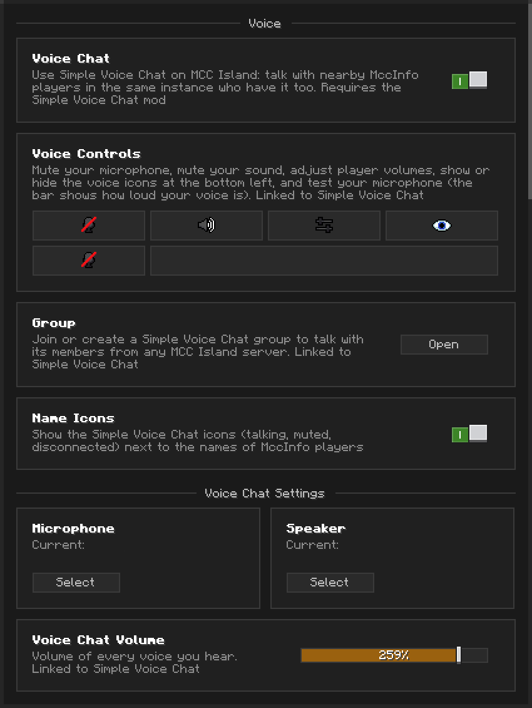

# MccInfo

Client-side Qol mod for [MCC Island](https://mccisland.net), Minecraft 26.2.

## Requirements

---
- Minecraft 26.2
- [Fabric Loader](https://fabricmc.net/use/) 0.19.3 or newer
- [Fabric API](https://modrinth.com/mod/fabric-api)
- [Noxesium](https://modrinth.com/mod/noxesium) 3.2.3 or newer
- [Simple Voice Chat](https://modrinth.com/plugin/simple-voice-chat) is optional.

## Features

---
Open the MccInfo menu to turn each feature on or off.

### Fishing
- **Fishing Messages**: moves fishing messages out of the chat into their own movable box, optionally only in fishing instances
- **Compact Fishing Messages**: merges each catch into one line with the item icon, triggered perks and earned XP
- **Fish Collection**: every fish you caught, your equipment and your perks
- **Best Island**: marks the island with the best chance of a new fish

### Events
Each MCC Island event gets its own page of settings and features in the MccInfo menu.

### Items
- **Item list**: searchable list of MCC Island items next to your inventory, with a calculator in the search bar
- **Recipes**: click an item to see its recipes and where it is used, from the list or any inventory (Hold Recipe Mode)
- **NPC path**: shows the way to the vendor of an item
- **Inventory Buttons**: command buttons next to your inventory

<table>
  <tr>
    <td align="center"> Item list</td>
    <td align="center"> Recipe preview</td>
  </tr>
  <tr>
    <td align="center"> Loot preview</td>
    <td align="center"> Inventory Buttons</td>
  </tr>
</table>

### Chat
- **MccInfo Chat**: talk with every MccInfo player, in the chat or in its own movable box, with an optional message sound
- **Chat Ping**: your name becomes @YourName and the message is highlighted, with an optional sound and taskbar flash
- **Copy Chat Messages**: Ctrl + Right Click a message to copy it
- **Emojis Box** and **Auto Emojis** (MCC+): pick your MCC Island emojis in a box, or type their names like `:smile:`
- **Share items**: press Copy Item on an item, then write `<item>` in the MccInfo Chat to share it with its full tooltip

### Voice Chat (with Simple Voice Chat, and only on MccIsland)

> [!WARNING]
> The voice chat is not endorsed, managed or moderated by The Noxcrew, and The Noxcrew is not responsible for anything said or done in it.

- Talk with nearby MccInfo players in the same instance
- Voice controls, volumes per player, groups you can join from any MCC Island server
- Microphone settings: gain, auto gain, noise suppression, push to talk or voice activation, microphone test
- Voice icons next to the names of MccInfo players

### Utils
- **Wipe to Black**: replaces the server's fade transition with a wipe
- **Keybinds Layout**: see your keybinds on a keyboard and assign them more easily
- **/travel**: go to a fishing island or a hub destination in one command
- Patch notes shown in game after each update

## Auto Update

---
Automatic updates are reserved for people close to the developer. If you are one of them, you can ask for access. Everyone else gets a download link when a new version is out (see below).

When the MccInfo relay asks for a newer version, a toast offers to install it. Nothing is installed until you click **Install**; the game then restarts on the new version. You can also open the toast again with `/mccupdate`.

Every update goes through these checks before it replaces the mod:

- **Pinned connection**: the jar is downloaded only from the MccInfo relay, over TLS pinned to the relay's public key, with no redirects.
- **Size**: the file must have exactly the size announced by the relay (64 MB at most).
- **SHA-256**: the hash of the downloaded file must match the one announced by the relay.
- **Ed25519 signature**: the version and the hash must be signed by the MccInfo update key. Its public half is built into the mod; the private key never leaves the developer's computer and is not in this repository. A jar that fails any check is deleted.
- **No downgrade**: an older version is never installed.
- **Only its own jar**: the update replaces the running MccInfo jar and nothing else in your mods folder.

Without automatic updates, the toast opens a download link instead (https only), and you replace the jar yourself.

## Credits

---
- [Essential](https://github.com/SparkUniverse/Essential-Mod) and [Trident](https://github.com/pe3ep/Trident), whose menu and interface style MccInfo follows to keep a consistent UI with the mods players already use.

> [!NOTE]
> MccInfo is not affiliated with, endorsed by or associated with The Noxcrew or Mojang.